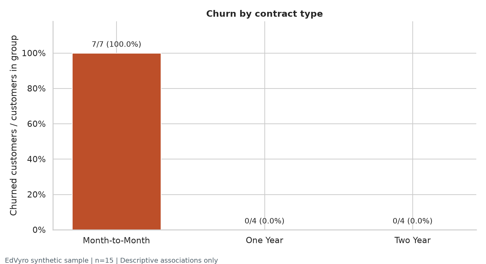
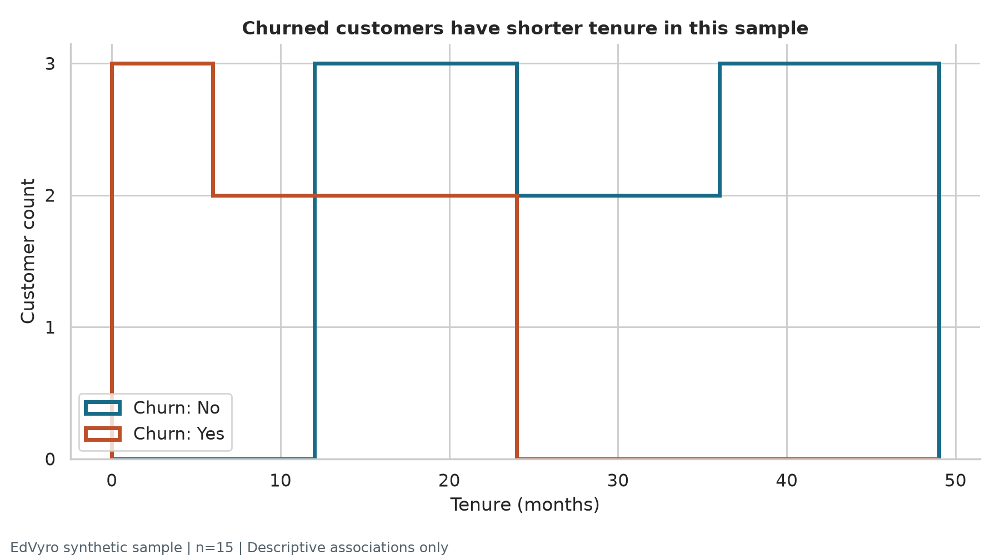

# Customer churn: quality first, then exploration

**EdVyro Data Analytics Internship - Task 02**

A reproducible audit and descriptive analysis of EdVyro's supplied synthetic customer churn sample. The pipeline preserves valid behavior, makes cleaning decisions explicit, and produces an executed notebook, aggregate quality report, and eight figures.

**Submission status:** analysis and public review materials are complete. The mandatory cleaned CSV exists locally but is **not publicly delivered**. EdVyro redistribution permission or an approved private delivery route is still required. No customer-level source records are included in this repository or notebook outputs.

## Problem and objectives

Which customer groups should a fictional subscription team investigate first for avoidable churn? Establish data quality before interpreting patterns. Profile columns, missing values, duplicates, categories, numeric validity, and IQR extremes; export a validated local CSV; inspect distributions and group churn rates; explain uncertainty and a measurable next step.

## Results at a glance

| Metric | Executed result |
| --- | ---: |
| Supplied customers / fields | 15 / 11 |
| Churned customers | 7 / 15 (46.7%) |
| Missing cells / exact duplicate excess / duplicate ID excess | 0 / 0 / 0 |
| IQR flags across numeric fields | 0 |
| Customer records removed or imputed | 0 |
| Mean tenure, churned / retained | 7.00 / 29.13 months |
| Mean monthly charges, churned / retained | 58.56 / 107.49 |
| Mean support tickets, churned / retained | 4.29 / 1.00 |

All seven Month-to-Month customers churned; none of the eight customers with other contracts did. This perfect separation and the very small synthetic sample prevent reliable estimates of independent effects. These are descriptive sample findings, not predictions or causes. The churn denominator is the supplied snapshot, not a defined monthly population.





## Source and access restrictions

The [official curriculum](https://edvyro.in/internships/data-analytics) lists this as milestone 2. The [task guide](https://edvyro.in/datasets/task-kits/data-analytics-task-1) internally calls the first domain project TASK-1 and links `customer_churn_sample.csv`. The downloaded file has 15 synthetic records and 11 fields. No newer matching material was found in the workspace or accessible Downloads tree. An unauthenticated fetch of the dataset endpoint returned HTTP 403, so a byte-for-byte live comparison was unavailable.

See [source provenance and SHA-256](src/provenance.json) and [authorized input instructions](data/raw/README.md). The generic source-library guide differs from the CSV in naming and contract categories. Actual headers and labels are preserved. INR and the 90-day ticket window are tentative guide mappings, not verified CSV metadata. There are no individual subscribed-service columns; tier is analyzed instead.

[EdVyro terms](https://edvyro.in/legal/terms) restrict redistribution of platform materials. The owner has no explicit dataset redistribution permission and directed that raw and cleaned customer-level data stay local. The original PDF, downloaded task brief, raw CSV and cleaned CSV are excluded from Git. No blanket dataset license is asserted. Public aggregates are shared under the project owner's instruction. An authorized reviewer needs the original input to rerun the analysis; this is not a data-inclusive public package.

## Workflow and cleaning policy

`Authorized local CSV -> schema and quality audit -> deterministic cleaning -> validation and local CSV -> aggregate EDA -> reports, figures and executed notebook`

- Normalize surrounding whitespace and known category casing; preserve identifier case.
- Parse numeric types explicitly; fail on invalid values, missing required fields, unknown labels or conflicting IDs.
- Remove only fully identical duplicates; preserve meaningful records and targets.
- Use IQR extremes and billing/age consistency as review diagnostics; never cap or delete an outlier automatically.
- Reopen the exported CSV and compare it with the validated in-memory output.

The supplied input required **zero value corrections**. All 15 rows remain intact. Zero affected rows are recorded in the [cleaning log](reports/cleaning_decisions.csv), rather than inventing defects to demonstrate cleaning. Category vocabularies describe this input and must be reviewed for future data. See the [before/after comparison](reports/quality_comparison.csv) and [quality report](reports/data_quality_report.md).

## Reproduce with authorized data

Python 3.11 was used. All commands below run from the repository root. No paid API or network data download is required for analysis.

1. Clone the repository and create a virtual environment.

   ```powershell
   git clone https://github.com/Dhaksith-S/EdVyro-Task2.git
   cd EdVyro-Task2
   python -m venv .venv
   .\.venv\Scripts\python.exe -m pip install -r requirements.txt
   ```

2. Obtain the CSV through your authorized EdVyro access and place it at `data/raw/customer_churn_sample.csv`. Compare its SHA-256 with [provenance](src/provenance.json). Never substitute unrelated data. Missing input produces an actionable error.

3. Generate and validate the local CSV, reports and figures; build and execute the notebook.

   ```powershell
   .\.venv\Scripts\python.exe -m src.data_cleaning
   .\.venv\Scripts\python.exe -m src.analysis
   .\.venv\Scripts\python.exe -m src.build_notebook
   .\.venv\Scripts\python.exe -m pytest -q
   ```

On macOS/Linux use `.venv/bin/python` in place of `.\.venv\Scripts\python.exe`. To open the executed notebook interactively, run `.\.venv\Scripts\python.exe -m jupyterlab notebooks/customer_churn_eda.ipynb`. For a fresh notebook execution without rebuilding its content, run:

```powershell
.\.venv\Scripts\python.exe -m nbconvert --to notebook --execute --inplace notebooks/customer_churn_eda.ipynb
```

Reports and figures are regenerated from code. No absolute machine paths or credentials are needed. The sample's exact checksum is intentionally tested; a newer authorized input requires a reviewed provenance update. Tests require the local input and generated artifacts. See [executed verification evidence](reports/verification.md).

## Project layout and deliverables

```text
EdVyro-Task2/
|-- README.md
|-- requirements.txt             # pinned direct dependencies
|-- requirements-lock.txt        # complete tested environment
|-- .gitignore
|-- data/
|   |-- raw/                    # local input, ignored except access notes
|   `-- processed/              # local cleaned CSV, ignored except delivery notes
|-- notebooks/customer_churn_eda.ipynb
|-- src/
|   |-- data_cleaning.py
|   |-- data_validation.py
|   |-- analysis.py
|   |-- build_notebook.py
|   `-- provenance.json
|-- reports/
|   |-- data_quality_report.md
|   |-- executive_summary.md
|   |-- cleaning_decisions.csv
|   |-- submission_checklist.md
|   `-- ...                     # aggregate audit tables and verification
|-- figures/                    # eight PNGs, 200 dpi
`-- tests/test_pipeline.py
```

| Deliverable | Review link / status |
| --- | --- |
| Executed Jupyter notebook | [Customer churn EDA](notebooks/customer_churn_eda.ipynb) |
| Cleaned customer CSV | Local `data/processed/customer_churn_cleaned.csv`; [authorized delivery pending](data/processed/README.md) |
| Data-quality summary | [Quality report](reports/data_quality_report.md) |
| Executive summary | [Measured findings and recommendations](reports/executive_summary.md) |
| Data dictionary and schema | [Schema audit](reports/schema_audit.csv) |
| Cleaning decisions | [Executed cleaning log](reports/cleaning_decisions.csv) |
| Statistics and categories | [Numeric summary](reports/summary_statistics.csv), [group rates and counts](reports/category_summary.csv) |
| Validation and comparison | [Validation results](reports/validation_results.csv), [before/after](reports/quality_comparison.csv) |
| Final requirements review | [Submission checklist](reports/submission_checklist.md) |

## Technologies and verification

Python, pandas, NumPy, Matplotlib, Seaborn, Jupyter, nbformat/nbconvert and pytest. [Direct dependencies](requirements.txt) pin the tested versions; [complete environment lock](requirements-lock.txt) records transitive versions. For the exact tested Windows Python 3.11 environment, install with `-r requirements-lock.txt` instead. The lock includes Windows-specific packages; use `requirements.txt` on other operating systems.

Tests cover source integrity, required schema, missing and invalid fields, exact and conflicting duplicates, formatting corrections, reproducibility, source/target preservation, outlier retention, target review, CSV round-trip integrity, report consistency, notebook execution, figure readability and relative references. Fault-injected copies exist only in memory and are never published as source data.

## Recommendation and conclusion

For the fictional retention team, investigate early-tenure monthly-contract customers with repeated support contacts in a larger, properly scoped dataset. Record ticket reasons, resolution times and next-period outcomes, and use a prospective comparison to test a retention hypothesis. No revenue-saved estimate, causal claim or predictive model is justified by these 15 records.

The analysis is reproducible for an authorized dataset holder and all public outputs are aggregate only. Submit this repository URL as the public review entry point, together with an EdVyro-approved route for the cleaned CSV. **The full mandatory submission remains incomplete until that CSV is delivered through an authorized method.**
